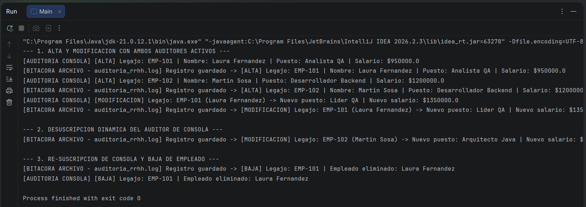

- Diseño de Software - Módulo 4
- Ejercitación 4.E.1 - Patrón Observer
Ejercicio 3: Registro Automático de Auditoría por Consola
Contexto del problema:
Un sistema de gestión empresarial requiere que cualquier operación crítica realizada sobre los registros de empleados (como alta, baja o modificación de datos) sea informada de manera automática a un módulo de auditoría en consola y a un sistema de bitácora en archivo sin acoplar la lógica de negocio principal.

Objetivo de aprendizaje:
Utilizar el patrón Observer para canalizar eventos de negocio hacia múltiples receptores independientes de manera ordenada.

Requisitos funcionales:

Disparar un evento de auditoría cada vez que un empleado sea modificado en el sistema central.

Enviar el mensaje de auditoría de manera simultánea al módulo de consola y al módulo de archivos registrados como oyentes.

Restricciones técnicas:

La lógica de negocio del empleado no debe contener llamadas directas a las clases de escritura en archivo o consola.

La suscripción y desuscripción de los auditores debe poder realizarse dinámicamente durante la ejecución del programa.
***
# Lógica y Funcionamiento del Programa:
    Para resolver este ejercicio apliqué el patrón Observer para separar completamente la administración de empleados de los mecanismos de registro y auditoría del sistema.

- Interfaz Observador: Define el contrato común actualizar(String tipoOperacion, String detalle) mediante el cual los distintos módulos de auditoría reciben los eventos del sistema.

- Interfaz SujetoObservable: Establece los métodos registrarObservador(), eliminarObservador() y notificarObservadores() para administrar dinámicamente los oyentes activos.

- Clase Empleado: Representa la entidad de negocio pura con sus datos básicos (legajo, nombre, puesto y salario), sin dependencias hacia módulos de salida.

- Clase SistemaEmpleados: Implementa SujetoObservable y centraliza las operaciones de alta, modificación y baja de empleados. No contiene ninguna llamada directa a consola ni a archivos; cada vez que modifica un registro, actualiza el evento reciente y notifica automáticamente a todos los observadores suscritos.

- Clases AuditorConsola y BitacoraArchivo: Son los observadores concretos. Cada uno implementa Observador y canaliza el mensaje recibido hacia su medio correspondiente (pantalla o archivo de registro).

- Clase Main: En la prueba suscribí ambos auditores, ejecuté altas y modificaciones, desuscribí dinámicamente el auditor de consola durante la ejecución para comprobar que solo el archivo seguía registrando cambios, y luego volví a suscribirlo antes de procesar una baja.
***
# Ejecucion por consola
